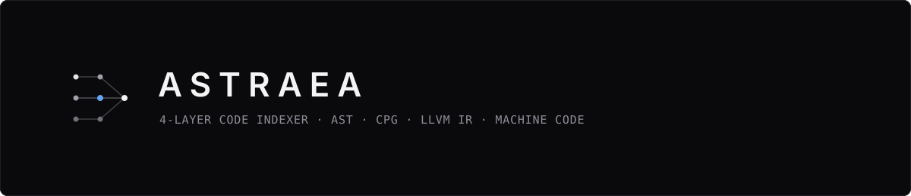

# Astraea

Astraea is a 4-layer code indexer, semantic graph analyzer, and AI code reviewer. It unifies syntax, call-graph, intermediate representation, and machine-code evidence so both automated CI reviews and MCP coding agents operate on grounded program structure rather than raw diffs or metrics alone.

## Architecture

Astraea indexes source repositories across four aligned layers:

1. **Layer 1 (AST & Lexical):** Tree-sitter parsing and structural chunking for C, C++, Rust, Python, and JavaScript, computing cyclomatic complexity and normalized token/AST vectors.
2. **Layer 2 (SCIP / CPG):** Cross-file Code Property Graph (`CALLS`, `IMPLEMENTS`, `REACHES`, and `CFG_NEXT` edges) with edge-level confidence (`confirmed`, `heuristic`, `ambiguous`, `contradicted`), enabling cycle-safe k-hop caller/callee impact slicing and blast-radius analysis.
3. **Layer 3 (IR / Bytecode):** Compiler lowering via `clang` / `rustc` to LLVM SSA IR (with Weisfeiler-Lehman graph vector isomorphism for NFC refactor proofs and IR-to-CPG call validation), plus `dis` bytecode lowering for Python modules and functions.
4. **Layer 4 (Machine Code & DWARF):** ELF disassembly via `lief` and `capstone` aligned back to source line ranges using DWARF debug metadata.

When generating an AI review with Gemini (via Vertex AI or `GEMINI_API_KEY`), Astraea attaches deterministic findings, source code for top complexity/blast-radius hotspots, and bounded 1-hop CPG caller/callee source snippets to prevent attention dilution and stay within token budgets.

## Installation

Requires Python 3.11+ and optionally `clang-18` / `rustc` for native C/C++/Rust IR lowering.

```bash
pip install -e ".[dev,gcp]"
```

## Usage

### 1. Pull Request Review (`--mode pr`)

Resolves the `git merge-base` between `--base` and `--head`, compares both worktrees across all four layers, verifies semantics-preserving (NFC) refactors, computes caller blast radius, and optionally generates a Gemini review:

```bash
astraea-review \
  --mode pr \
  --repo . \
  --base HEAD~1 \
  --head HEAD \
  --out-md pr_review_summary.md \
  --out-comments pr_review_comments.json
```

### 2. Periodic Repository Audit (`--mode repo`)

Scans the repository, clusters semantic clones, scales complexity/blast-radius findings, lists degraded units, and diffs against a previous baseline when `--baseline` is provided:

```bash
astraea-review \
  --mode repo \
  --repo . \
  --baseline .astraea_baseline.json \
  --out-baseline .astraea_baseline.json \
  --out-md repo_review_summary.md
```

### 3. Enabling Gemini via Vertex AI or API Key

Pass Vertex AI flags or set `GEMINI_API_KEY`:

```bash
astraea-review \
  --mode repo \
  --repo . \
  --vertex-project YOUR_GCP_PROJECT_ID \
  --vertex-location global \
  --gemini-model gemini-4-hydrogen \
  --out-md repo_review_summary.md
```

For GitHub Actions integration, see [.github/workflows/ci.yml](.github/workflows/ci.yml), [.github/workflows/pr-review.yml](.github/workflows/pr-review.yml), [.github/workflows/periodic-review.yml](.github/workflows/periodic-review.yml), and [src/pr_bot/README.md](src/pr_bot/README.md).

### 4. MCP Server (`astraea-index`)

Runs the stdio Model Context Protocol server exposing multi-layer indexing, hybrid search, and CPG traversal tools:

```bash
astraea-index
```

| Tool | Purpose |
| :--- | :--- |
| `index_workspace` | Incrementally indexes a repository across AST, CPG, IR, and binary layers, returning `ir_cpg_validation` counts. |
| `search_code_hybrid` | Searches indexed units using Weighted Reciprocal Rank Fusion (RRF) across Tantivy lexical and Qdrant AST/IR/CFG vectors. |
| `inspect_lowering_pipeline` | Returns AST metadata, SCIP URI, LLVM IR summary, paginated binary basic blocks, and `degraded_reason` within token budget. |
| `find_ir_or_binary_clones` | Finds semantically equivalent functions across optimization levels or syntax variants. |
| `trace_symbol_dataflow` | Performs cycle-safe k-hop CPG traversal for a SCIP symbol URI. |
| `get_index_health` | Reports storage consistency across memory, Tantivy, Qdrant, and SQLite, plus pending tombstones and CPG counts. |

## Incremental Indexing & Hybrid Storage

- **Persistent Incremental State:** File hashes, unit mappings, and the CPG are persisted in SQLite (`file_state`, `units`, `snapshots`) and restored on `CodeIndexPipeline` startup.
- **Compiler-Aware Cache Keys:** Per-file SHA-256 keys incorporate file contents, `compile_commands.json` flags, active compiler `--version`, and transitive local `#include "..."` header hashes for C/C++.
- **Crash-Safe Storage Sync:** `HybridCodeStore.apply_batch` commits `units`, `snapshots`, `tombstones`, and `file_state` inside a single SQLite transaction before syncing Tantivy and Qdrant, protected by a re-entrant lock (`RLock`) for concurrent reads and writes.
- **Ignored Directories:** Heavy build and dependency directories (`node_modules`, `build`, `dist`, `target`, `venv`, `.venv`, `__pycache__`, `vendor`, and dot-directories) are skipped automatically.

## Security & Resource Limits

- **Compiler Sandboxing:** `sanitize_compile_flags` allowlists safe preprocessor/standard/include flags and strips `-fplugin`, `@response_file`, and arbitrary compiler flags.
- **Subprocess Caps:** Compiler invocations run with `shell=False`, a 15-second timeout, and a 2 GB `RLIMIT_AS` memory cap on POSIX systems.
- **Disassembly & Output Caps:** `BinaryLifter` caps disassembly at 1 MiB and 50,000 instructions per function; MCP responses are bounded by `DEFAULT_TOKEN_BUDGET`; `degraded_reason` reports sanitized failure categories without echoing included source lines.

## Language Support & Limitations

| Language | Supported Layers | Notes & Limitations |
| :--- | :--- | :--- |
| **C / C++ / Rust** | Tree-sitter AST, CPG, LLVM IR, ELF/DWARF | Lowered as standalone translation units without full Cargo or CMake build graphs; external headers, crate dependencies, or custom build flags may degrade IR/binary lowering. |
| **Python** | Tree-sitter AST, CPG, `dis` bytecode CFG | Bytecode control-flow graphs are extracted via standard-library `dis` without native ELF/DWARF lowering. |
| **JavaScript** | Tree-sitter AST, CPG | IR and machine-code layers report `IRStatus.NOT_APPLICABLE`. |

Dynamic dispatch, C++ template instantiation across translation units, and macro-expanded call sites remain heuristic unless a SCIP index or LLVM IR confirmation is available.

## Backup, Restore & Health Diagnostics

`HybridCodeStore` provides diagnostics and recovery primitives for its SQLite, Tantivy, and Qdrant backends:

- `HybridCodeStore.health_check()` (and the `get_index_health` MCP tool): reports backend status, vector/document counts, `sqlite_ok`, and `pending_tombstones`.
- `backup_sqlite(dest_path)` / `restore_sqlite(src_path)`: creates and restores consistent SQLite index snapshots using SQLite's online backup API.
- `recover_from_sqlite()`: replays SQLite tombstones and reconciles Tantivy and Qdrant state with SQLite on startup.

## Benchmarks

Run the cross-language CPG accuracy, synthetic indexing/search, and real-repository benchmarks (see [benchmarks/README.md](benchmarks/README.md)):

```bash
PYTHONPATH=src python benchmarks/bench_astraea.py --check-thresholds
```

## Development Checks

```bash
ruff check src/ tests/ benchmarks/
mypy --strict src/
pytest -v --tb=short
```
